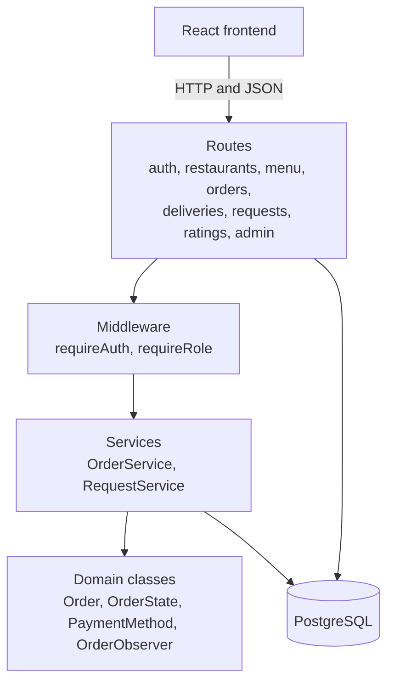
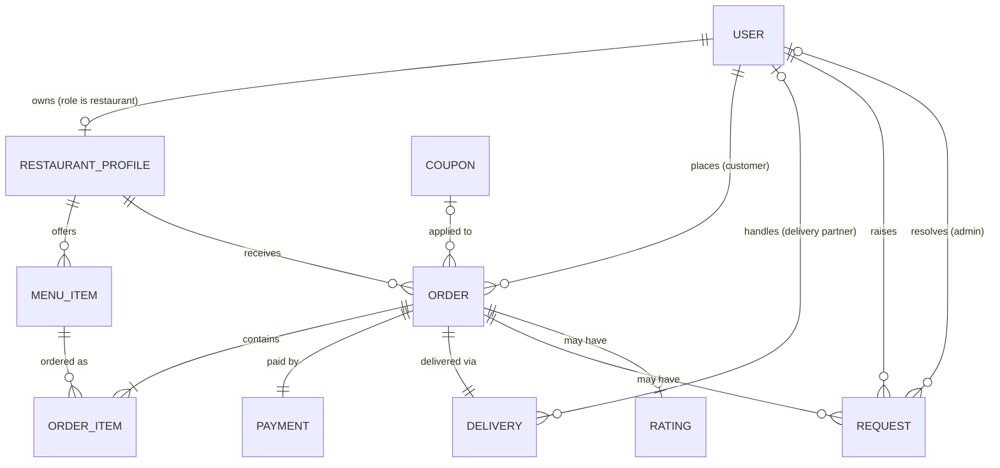

# Hungry Bird

A food delivery web app with four kinds of users: **customers** who order, **restaurants** that prepare, **delivery partners** who deliver, and an **admin** who resolves problems. Built as a course project for Object-Oriented Programming and Database Management Systems.

**Stack:** React (Vite), Node.js with Express 5, PostgreSQL.

## What it does

| Role | Can do |
|---|---|
| **Customer** | Browse restaurants and menus, see ratings and reviews, fill a cart, enter a delivery address (the last one is remembered), apply a coupon, pay (mock), track an order, cancel it while it is still new, see past orders, rate a delivered order, raise a request about an order |
| **Restaurant** | Add, edit, hide and delete menu items, receive orders, move them through accepted, preparing and ready, see past orders |
| **Delivery partner** | See orders waiting for a driver, accept one (the drop-off address is revealed after accepting), mark it picked up, out for delivery and delivered, collect cash on delivery, see past orders and total earnings |
| **Admin** | See every order, force any status on a stuck order, ban and unban users, create and list coupons, resolve customer requests with or without a refund |

## Architecture



Routes check input and permissions. Services run the business rules inside database transactions. The domain classes hold the rules that need no database, such as which status can follow which.

## Database

Ten tables, with all four roles in a single `user` table distinguished by a `role` column. The schema is in `db/schema.sql`.



The design is in third normal form, with two deliberate choices:

- **`order_item.price_at_order_time`** copies the price when the order is placed. A restaurant can change its menu price later, and old orders must keep showing what was actually charged.
- **`order.total_amount` and `discount_amount`** are stored, not recalculated, for the same reason: the coupon or menu may change after the order.
- **`order.delivery_address`** is stored on the order, not on the user, for the same reason again: a customer may move or order to a friend's house, and an old order must keep showing where it was actually delivered.

## Object-oriented design

Three design patterns carry the order logic (see `docs/class-diagram.md` for the diagrams):

| Pattern | Where | What it buys |
|---|---|---|
| **State** | `OrderState` and its 8 subclasses | Each status knows its next status, which role may move it, and who may cancel it. Illegal jumps are blocked in one place. |
| **Strategy** | `PaymentMethod` with card, UPI and cash on delivery | Adding a payment method means one new class, with no change to the order code. |
| **Observer** | `OrderObserver` with customer, restaurant and delivery partner notifiers | The order announces each status change without knowing who is listening. |

Roles are **not** subclasses of a `User` class. They differ in what they may do, not in the data they hold, so a role column and the `requireRole` middleware are enough.

## Key engineering decisions

- **Placing an order is one transaction.** The order, its items, the payment and the delivery record are saved together or not at all. `backend/test/orderService.test.js` forces a failure halfway and checks that nothing is left behind.
- **Prices come from the database, never from the request**, so a customer cannot change what they pay.
- **Row locks prevent races.** The coupon row is locked while it is checked and counted, so two orders cannot both use the last redemption. The order row is locked while a refund is checked, so refunds can never add up to more than the customer paid. Accepting a delivery is a single `UPDATE ... WHERE status = 'unassigned'`, so two drivers cannot both win.
- **A ban takes effect immediately.** Every protected request re-reads the user from the database, so a banned user is locked out on their next request, not when their token expires.
- **Orders belonging to someone else return 404, not 403**, so nobody can discover which order ids exist.
- **The delivery address is shared on a need-to-know basis.** The customer, the assigned delivery partner and the admin see it. The restaurant never receives it, and a delivery partner only sees it after accepting the delivery.
- **All queries are parameterized** (`$1, $2, ...`), which prevents SQL injection. Passwords are stored as bcrypt hashes.

## Running it locally

**Requirements:** Node 20 or newer, PostgreSQL 16.

```
# 1. Database
createdb -U postgres hungrybird
psql -U postgres -d hungrybird -f db/schema.sql
psql -U postgres -d hungrybird -f db/seed.sql        # demo data (wipes the tables first)

# 2. Backend (copy .env.example to .env first and fill it in)
cd backend
npm install
npm run dev                                           # http://localhost:3000

# 3. Frontend, in a second terminal
cd frontend
npm install
npm run dev                                           # the address Vite prints
```

### Demo accounts

| Email | Password | Role |
|---|---|---|
| `admin@hungrybird.com` | `admin123` | admin |
| `asha@test.com`, `rohan@test.com` | `password123` | customer |
| `ravi@test.com` (Ravi Dosa Corner), `meena@test.com` (Meena's Kitchen) | `password123` | restaurant |
| `kiran@test.com`, `sunil@test.com` | `password123` | delivery partner |

Coupons in the demo data: `WELCOME10` (10% off from 100), `FLAT50` (50 off from 250), and `EXPIRED20` (expired, for testing the error).

### Try the whole flow

1. As **asha**, order from Ravi Dosa Corner with `WELCOME10`.
2. As **ravi**, open the order and move it to accepted, preparing, then ready.
3. As **kiran**, accept it under Available deliveries and mark it picked up, out for delivery, then delivered.
4. As **asha**, rate the order and raise a request.
5. As the **admin**, refund the request, then ban and unban a user and create a coupon.

## Tests

```
cd backend
npm test
```

`domain.test.js` needs no database and covers the order state machine, the observers, the payment strategies and the coupon and refund validation. `orderService.test.js` checks the transaction rollback and needs the database running.

## Documentation

| File | What is in it |
|---|---|
| `backend/README.md` | Every API endpoint, with requests, responses and error codes |
| `docs/class-diagram.md` | Class diagrams and the reasoning behind them |
| `docs/sql-queries.md` and `db/queries.sql` | Three analytical queries with expected output |
| `docs/index-experiment.md`, `db/perf_setup.sql`, `db/index_experiment.sql` | The index experiment on 200,000 orders |
| `docs/deployment.md` | Free deployment on Neon, Render and Vercel |
| `docs/viva-prep.md` | Demo script and likely questions with answers |

## Screenshots

Add screenshots here, taken from your own running app. Suggested set: the restaurant list, a menu, the cart with a coupon, an order in progress, the restaurant's order page, the delivery partner's available deliveries, the admin requests page and the admin users page.

## Known limitations

- **The delivery address is free text.** There is no map, address validation, saved address book or distance estimate, and a customer cannot edit the address after ordering.
- **Payments are mocked.** Card and UPI always succeed, and cash on delivery is marked complete when the order is delivered. A refund is recorded on the request and does not change the payment record.
- **Notifications are console messages only.** The observer structure is in place, but nothing is sent to a phone or email.
- **The delivery payout is a flat 40 per order.**
- **No pagination, rate limiting, password reset or email verification.**
- **The login token is kept in the browser's local storage.** That is simple but exposed to cross-site scripting. A production app would use an httpOnly cookie.
- **Coupons cannot be edited or deactivated after creation.**

## Project structure

```
backend/                 Express API
  src/routes/            auth, restaurants, menu, orders, deliveries, requests, ratings, admin
  src/services/          order and request business logic (transactions)
  src/domain/            order states, payment strategies, observers
  src/middleware/        authentication and role checks
  test/                  automated tests
db/                      schema, demo data, queries, index experiment
docs/                    diagrams, SQL notes, deployment guide, viva prep
frontend/                React app (one page per feature, for every role)
```

## Authors

Add the names of everyone on your team here.
