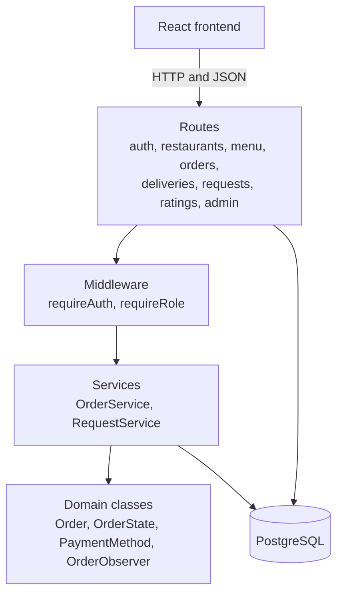
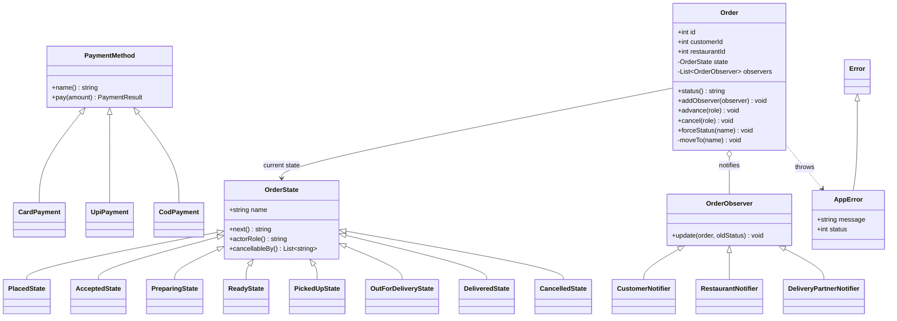
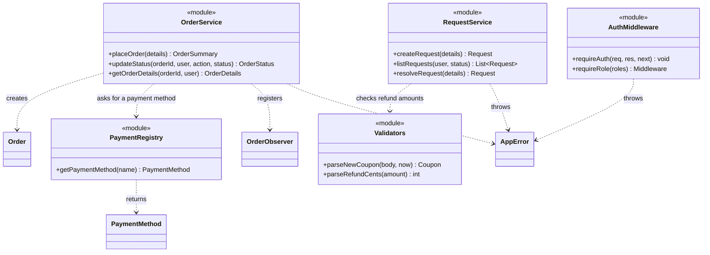

# Hungry Bird: class diagrams

These diagrams describe the **backend code as it exists**. The database design is in the ER diagram. Three design patterns carry the object-oriented design: **Strategy** (payments), **State** (order status) and **Observer** (notifications).

## 1. Layers

A request passes through four layers, and each layer only talks to the one below it.

Routes check input and permissions. Services run the business rules inside database transactions. The domain classes hold the rules that need no database, such as which status can follow which.

## 2. Domain classes (the three patterns)

`+` means public and `-` means private. In the JavaScript code, a private field is written with `#` (for example `#state`), but the diagram uses the standard UML symbols. JavaScript has no `interface` keyword, so `OrderState`, `PaymentMethod` and `OrderObserver` are base classes whose methods throw "not implemented" or return a safe default.

| Pattern | Classes | Why it is used |
|---|---|---|
| **State** | `OrderState` and its 8 subclasses | Each state knows its own next status, which role may move it, and who may cancel it. Illegal jumps are blocked in one place, and a new status means one new class. |
| **Strategy** | `PaymentMethod`, `CardPayment`, `UpiPayment`, `CodPayment` | Placing an order only calls `pay(amount)`. Adding wallet payments means one new class and one registry entry, with no change to `OrderService`. |
| **Observer** | `OrderObserver` and 3 notifiers | `Order` announces every status change to whoever is subscribed, without knowing who they are. |

## 3. Services and middleware

`OrderService.placeOrder` is one database transaction. It checks the restaurant, reads prices from the database, applies the coupon, and inserts the order, items, payment and delivery, or rolls back the whole thing if any step fails. `RequestService.resolveRequest` locks the order row so the refunds on one order can never add up to more than the customer paid.

## 4. Why the four roles are not subclasses of a `User` class

In the database, all four roles live in one `user` table with a `role` column. In the code, a role is a value that `requireRole` checks, not a class. Roles differ in what they are **allowed to do**, not in what data they hold or how objects of that type behave, so a `Customer` class and a `RestaurantOwner` class would carry the same fields and no distinct logic.

The real polymorphism is where behavior varies by type: how a payment is processed (Strategy), what a status allows (State), and who gets told about a change (Observer). If you are asked in the viva, "I chose the pattern where the behavior actually differs, and used a role column and middleware where only the permissions differ."

## 5. Extending it: adding wallet payments

1. Add `class WalletPayment extends PaymentMethod` with `name` returning `'wallet'` and a `pay(amount)` method.
2. Add one entry to the `METHODS` map in `payments.js`.
3. Run `ALTER TYPE payment_method ADD VALUE 'wallet';` in the database.

`OrderService`, `Order` and every other payment class stay unchanged. The database enum is the only place that needs a manual step.
